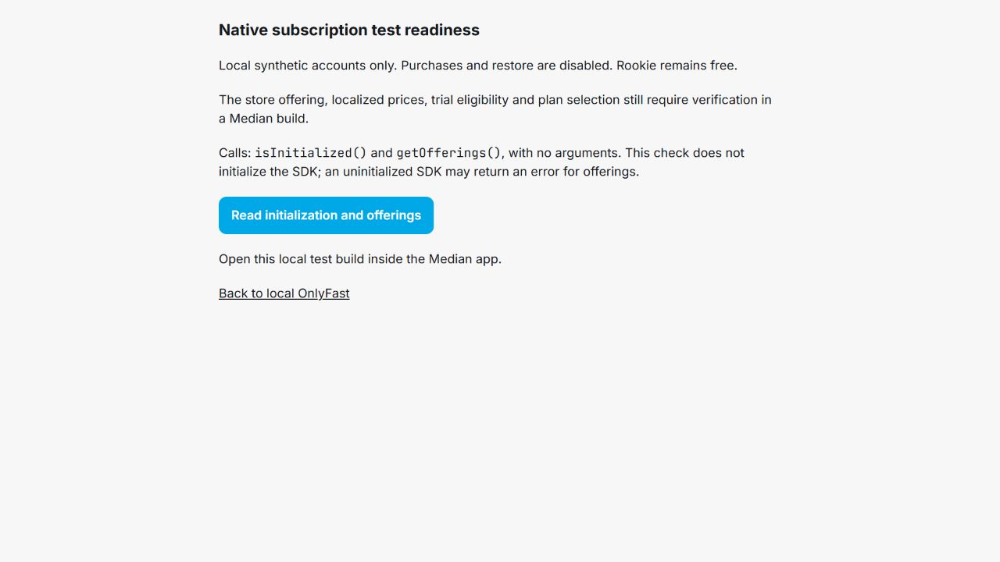

# OnlyFast: Median native purchase readiness

**October 17 follow-up:** the Android emulator's one real Pro sandbox purchase
was verified through RevenueCat and isolated local Supabase. The debug extension
is not a release bridge. See [the current onboarding/subscription integration
report](ONBOARDING_SUBSCRIPTION_INTEGRATION.md) for frontend changes, the retained
public hold and exact Android/iOS release work. Statements below about no observed
purchase describe the earlier October 16 audit, not the current test result.

**Read-only diagnostic update:** use [Median bridge device test](MEDIAN_REVENUECAT_BRIDGE_TEST.md)
for the extended initialization/offerings probe and USB Android instructions. A
Median support response is not a prerequisite to collecting this device evidence.

Audit date: October 16, 2026. **Native purchase implementation is blocked. No
successful device purchase or native purchase bridge execution has been observed.**
The user reports that the production backend is deployed and tested. Earlier
prebuild reports describe historical backend state; this report supersedes their
native purchase readiness and activation instructions.

## Compatibility and verified interface

Median offers its own RevenueCat Native Plugin, using the native iOS and Android
SDKs. React Native and Capacitor are unnecessary and were not installed. The
verified integration is the injected `median.revenueCat` JavaScript bridge
(legacy `gonative.revenueCat` is accepted by existing app code), not a browser
purchase SDK. Enablement belongs to Median App Studio and requires a native build.
[Median plugin documentation](https://docs.median.co/docs/revenue-cat).

The published implementation/types expose these methods:

| Method | Verified contract / limitation |
| --- | --- |
| `configure({apiKey, appUserID})` | Runtime public SDK key and identified user |
| `isInitialized()` | Initialized boolean and optional API key |
| `login({appUserID})`, `logout()` | Identity lifecycle |
| `getOfferings()` | Identifiers, error and success in types; no offering argument or price objects |
| `purchase({identifier})` | One identifier; no offering/package/offer-token argument |
| `restorePurchases()` | Native restore result |
| `presentPaywall({onCancelPurchase})` | Generic paywall; no named-offering argument |

No customer-info listener, detailed localized product response, trial-eligibility
API, or named-offering selector appears in this published bridge. This is a
limitation of the interface inspected, not proof that Median cannot supply an
extension. The prose `getOfferings` example omits `success`, while its TypeScript
contract requires it; obtain an actual device response before relying on either.
[Official bridge source](https://github.com/gonativeio/median-javascript-bridge/blob/master/src/plugins/revenueCat.ts),
[official response types](https://github.com/gonativeio/median-javascript-bridge/blob/master/src/types/revenueCat.ts).

## Read-only RevenueCat findings

Project `proj79983fe3` was inspected without changing configuration:

- `onlyfast_monthly_v1` (`ofrng35794ca3b5`) exists and is **not current**.
- The current offering is `default`; it has no paywall attached. A paywall ID on
  the requested offering does not establish that it is published or usable.
- Pro package: `$rc_monthly`; Teams: `$rc_custom_teams_monthly`.
- Android products: `pro:pro`, `teams:teams`, app `appd348665a60`.
- iOS products: `app.onlyfast.pro.monthly`, `app.onlyfast.teams.monthly`, app
  `app82192c9834`.
- Both store app identities are `app.onlyfast`. RevenueCat reports the Android
  service account and Apple API/subscription keys configured; store permission
  validity and real-device product loading remain untested.

[Existing offering](https://app.revenuecat.com/projects/79983fe3/product-catalog/offerings/ofrng35794ca3b5),
[existing apps](https://app.revenuecat.com/projects/79983fe3/apps).

The catalog response does not establish localized store prices or seven-day trial
eligibility. In particular, a null trial field is not sufficient to conclude a
Google offer is absent. Query the actual eligible store offers through the native
SDK. Do not substitute the website's $5/$8 display values for store evidence.

## Why purchasing is stopped

The existing app sends both Pro and Teams to `presentPaywall()` without a selected
plan or offering. Enabling its previous global flag would expose this incomplete
flow publicly. Its interface cannot demonstrate that it is loading the requested
non-current offering, distinguish the selected plan, or show real localized terms.

I did not guess at undocumented arguments, route through the current offering,
publish the paywall, change the offering, or simulate a successful purchase.
Median must provide a supported bridge revision/custom extension (or documented
evidence of an equivalent existing interface) that can:

1. Load `onlyfast_monthly_v1` by identifier without making it current.
2. Return each package's product, localized price/currency, billing period,
   eligible introductory offer/trial terms and relevant store offer selection.
3. Purchase the selected Pro/Teams package with an unambiguous offering context.
4. Report success, cancellation, pending/declined/error states and restoration;
   identify supported native entitlement-change notifications if available.

Until then, initialization and lifecycle code already present in the repository
remain dormant. They have unit coverage but are not certified against a Median
binary. Restore is held as well, because it can transfer receipt ownership.

## Changes prepared in this task

- An explicit readiness hold keeps native purchases and restore disabled even
  when `VITE_REVENUECAT_ENABLED=true`. Native paid plans remain Coming Soon.
- Subscription sync pins the captured user's bearer token and rejects a response
  after an account switch. Only the Edge Function/database can grant access.
- `native-sandbox` builds require explicit local Supabase credentials, reject
  cloud endpoints and service-role keys before client creation, use separate Auth
  storage, and emit to `dist-native-sandbox` instead of the production output.
- `/native-subscription-test` exists only in that build mode. Every check verifies
  the user through local Auth and freshly reads server-owned tester/flag rows via
  own-account RLS. It requires an enabled experimental test account and explicit
  `native_subscription_testing` flag; a full-access test override is rejected.
- The test screen inventories methods and calls `isInitialized()` and
  `getOfferings()` with no arguments, retaining their responses and errors.
  It does not configure identities, buy, restore, transfer receipts or grant access.
  A successful initialization query proves only that query responded; it does not
  prove purchases work. URL parameters, localStorage and editable user metadata do
  not authorize the check or enable purchases.
- An offline preparation script validates the existing staging manifest, actual
  migration bytes, local status and absence of a remote link; it refuses to
  overwrite its generated environment file.

No production function, SQL migration/history, Stripe checkout code, offering,
webhook credential, store configuration or customer record was changed.

## Using the local diagnostic build

Docker and Supabase CLI 2.121.0 were available. Reuse the existing isolated
`tmp/staging-database` workspace (`onlyfast-disposable-staging`) and its 16-migration
sequence. Do not run database commands from the linked repository root.

The preparation script is offline and requires an existing local CLI status JSON.
If refreshing that file, first verify the staging project ID and absence of
`supabase/.temp/project-ref` and `[remotes]`, then use only:

```powershell
npx.cmd --no-install supabase status --workdir ./tmp/staging-database --output json | Set-Content -Encoding ascii ./tmp/staging-database/local-status.json
node --experimental-strip-types scripts/prepare-native-sandbox.mjs ./tmp/staging-database http://127.0.0.1:54321
npx.cmd --no-install vite build --mode native-sandbox
npx.cmd --no-install vite --mode native-sandbox --host 127.0.0.1
```

For a physical device, choose the PC's private LAN IPv4 address at preparation
time, for example `http://192.168.1.50:54321`; run Vite on that same LAN interface.
The build guard only accepts loopback or RFC1918 private IP endpoints on port
54321. The example address must be replaced with the actual PC address. Device
`localhost` refers to the device, not the PC. Share a private network, permit only
the required LAN firewall traffic, and keep database/service-role ports private.
Do not upload this bundle or point the production Median app at it.

Median must allow the local test origin and local Supabase API, including Android
test-build cleartext-network settings or properly trusted local HTTPS certificates.
iOS similarly needs a test-build transport policy or trusted HTTPS. These native
settings cannot be changed in this repository. This implementation does not
support public tunnels; adding one needs a separate reviewed isolation approach.

Create new local Auth accounts only, using `@example.invalid` synthetic email
addresses and password login. Do not use production SSO, recovery links, sessions,
users or store accounts. Locally, an operator must register the
`native_subscription_testing` definition and explicitly assign its enabled flag
plus `is_test_account=true`, `beta_features_enabled=true`,
`tester_kind='experimental'` in the existing beta tables. Do this only through the
verified local container's SQL/admin interface; no browser writes are granted.
No production migration is needed for these local-only assignments. Leave
`test_account_full_access` disabled and avoid admin/promo overrides. The integration
test exercises these assignments temporarily and removes them afterward; it does
not leave a persistent enrolled account or password.

Sign into that account at `/`, then open `/native-subscription-test` in the Median
test wrapper. The route address is navigation only; it is not authorization.
The current prepared environment uses loopback and must be regenerated deliberately
for LAN use. Preparation refuses an existing `.env.native-sandbox.local` file.

## Safe method for a future real sandbox purchase

**This is a remaining setup procedure, not an enabled purchase path.** Production
must keep `REVENUECAT_ALLOW_SANDBOX=false`. No production setting was read or changed
in this task; its value is the user's supplied deployment context.

1. Resolve the Median catalog blockers above. Gate the eventual tester purchase
   entry point with the same explicit server-owned assignment, revalidated before
   each native action, and retain the public purchase hold. Extend this gate to a
   local server endpoint before enabling privileged sandbox operations.
2. Use only newly generated local Supabase UUIDs as RevenueCat appUserID. Initialize
   with the real **Android app's public SDK key**, not the RevenueCat Test Store
   key. Google license testing determines sandbox status; a made-up key does not.
   iOS later uses the real iOS app public key. Secret API keys stay in local server
   environment files and never receive a `VITE_` prefix.
3. The currently served local functions are **fixture wrappers** generated by
   `prepare-local-revenuecat-functions.mjs`. They intercept RevenueCat REST calls
   and return synthetic responses. They cannot validate a real purchase. Stop
   their serve process before switching modes; never treat fixture results as
   store receipts.
4. Prepare separate, local-only copies of the real sync/webhook handlers with an
   outbound guard permitting only the local Supabase service and RevenueCat's
   subscriber API. Require local synthetic tester UUIDs. Reject production
   transactions explicitly: `ALLOW_SANDBOX=true` alone also accepts production
   subscriptions and is insufficient isolation. Add sandbox-only snapshot/event
   validation and tests before serving these copies. Do not deploy these wrappers.
5. Provide a server-side RevenueCat secret manually to that local runtime and set
   `REVENUECAT_ALLOW_SANDBOX=true` **only there**. Keep the exact entitlement names
   `OnlyFast Pro` and `OnlyFast Teams` and native app ID allowlist. No live webhook
   credential changes are needed. Authenticated sync after purchase/resume can
   poll RevenueCat directly, avoiding any public tunnel or new webhook entirely.
6. For automatic renewal/cancellation tests, repeatedly invoke authenticated local
   sync to fetch real current snapshots; the local expiration cron still runs.
   If actual webhook delivery is also required, separately prepare a sandbox-only
   authenticated local relay/replay process restricted to the local UUID allowlist,
   or authorize an additional sandbox-only webhook integration. Do not repoint or
   reuse production webhook credentials. A fixture webhook is not delivery proof.
7. Use a clean device/profile and dedicated license-testing store account with no
   production purchases; never log into production OnlyFast from this test wrapper.
   RevenueCat restore/transfer policy affects receipt ownership across identified
   users. Review the existing policy before two-account testing; do not change it
   as a shortcut. Local UUIDs must never be provisioned into production Supabase.

[RevenueCat restore behavior](https://www.revenuecat.com/docs/projects/restore-behavior).

This approach uses existing Docker resources, not a paid Supabase branch. The
real-sandbox runtime guard, privileged endpoint and native purchase adapter are
still required work after Median supplies a supported interface and a test binary.

## Google Play internal testing acceptance

Use a signed Median AAB with package `app.onlyfast`, the RevenueCat native plugin
and correct public Android key. The Play Console owner must later upload a test
release to the internal track, invite testers and have each tester opt in and
install it through Play. No binary was generated, uploaded or released here.

Track membership and license-testing enrollment are separate. Add the intended
Google account to License testing as well. Internal-track users who are not
license testers can incur real charges. Confirm the purchase sheet names the
expected account, explicitly identifies a test purchase and offers Google's test
payment instruments. Stop if it requests a real payment method. Check the trial
offer's eligibility on the actual device; seven calendar days in the product
configuration is not the sandbox's accelerated elapsed duration. Billing Lab can
exercise eligible trials again and subscription transitions.
[Google billing testing](https://developer.android.com/google/play/billing/test).

Record evidence for each case on a physical device after the blockers are fixed:

| Case | Expected result |
| --- | --- |
| Rookie onboarding | Continues free, no store dialog |
| Pro / Teams | Correct named-offering package and localized terms before confirmation |
| Trial | Finite server-confirmed access; trial offer eligibility respected |
| Identity | RC appUserID equals local Auth UUID; no anonymous purchase attribution |
| Cancel / decline / offline / pending | No new paid grant without a verified server snapshot |
| User cancels auto-renewal | Access remains until store expiration |
| Renewal / expiration | Refresh follows real RC state; cron removes expired native projection |
| Restart / restore | Same identified account; sync verifies any returned access |
| Logout / account switch | Old response discarded; no inherited app access; restore policy honored |
| Duplicate / delayed events | No corrupt or stale projection |
| Existing Stripe fixture | Provider precedence and access preserved; no Stripe API requests |
| Ordinary user / forged metadata / URL / storage | No experimental purchase entry or paid grant |

RevenueCat's Google sandbox guide explains dashboard sandbox visibility and
accelerated renewals. Collect RC transaction IDs and local subscription snapshots
for actual purchases; mock/controller tests are not that evidence.
[RevenueCat Google sandbox](https://www.revenuecat.com/docs/test-and-launch/sandbox/google-play-store).

iOS follows only after Android: confirm the plugin-enabled signed development or
TestFlight build, bundle `app.onlyfast`, sandbox Apple account and eligible store
products. Apple subscription review submission is not part of this work.

## Validation and remaining blockers

See the final test results appended below. All store/native purchase acceptance
cases above remain unexecuted. **An Android purchase-test build is not ready.**

Required owner input: the current Median app/build identifier and plugin/version
availability; a supported Median catalog/selection extension or vendor response;
an authorized test AAB/device and designated Google license tester; the PC/device
network arrangement; and, later, a server-only RevenueCat credential for an
explicitly isolated real-sandbox runtime. Never paste that secret into source or
the client bundle. No new paid Median add-on or cloud resource was purchased.

No production deployment is proposed until the supported native adapter exists,
the real-device matrix passes, and a separate deployment is authorized. Keep the
public hold and production sandbox rejection throughout test preparation.

## Recorded test results

| Check | Result |
| --- | --- |
| `npm test` | 357 passed, zero failures; includes 6 new sandbox security/bridge tests |
| Focused sandbox tests after final fixture edits | 6 passed, zero failures |
| PostgreSQL/PGlite and mounted component regressions, `tests/*.mjs` | 52 passed, zero failures; local runtime suite intentionally skipped here |
| Actual local Docker Supabase suite | 14 passed, zero failures; includes fresh tester authorization/RLS and native cron execution |
| TypeScript application and Vite config projects | Passed |
| Production Vite build | Passed; diagnostic route and its page chunk excluded |
| Native sandbox Vite build | Passed, separate output directory |
| Focused ESLint | Zero errors; 5 existing unused-disable warnings when including `src/lib/supabase.ts` |
| Local browser diagnostic | Rendered; non-Median browser refused; no console errors, existing Router future-version warnings |
| Physical Android/iOS bridge, real purchase, localized products, store restore | Not executed; blocked on Median and test-build configuration |

The Docker checks used real local Auth JWTs, PostgREST, PostgreSQL/RLS, Edge Runtime
and pg_cron, with synthetic RevenueCat HTTP fixtures. They cover free Rookie,
Pro/Teams, finite trials, cancellation/expiration, retries, account isolation,
duplicate/stale webhooks, provider switching and Stripe preservation. The new gate
test proves that user metadata cannot enroll a tester, clients cannot write beta
assignments, another account cannot read tester rows, and a full-access override
blocks this diagnostic authorization. Cleanup left zero local Auth users,
subscription rows, webhook events and native-test feature definitions.

Builds retain the existing Vite large-chunk advisory. No production migrations or
Edge Function source files changed in this task. Existing staging work was reused;
the local integration test file gained only the tester authorization scenario.
Test logs are in ignored `tmp/native-sandbox-*.log` and
`tmp/native-production-build.log`. The generated `.env.native-sandbox.local` is
ignored and contains local public configuration only, with purchases disabled.

Local browser verification (regular browser refused before native calls):


