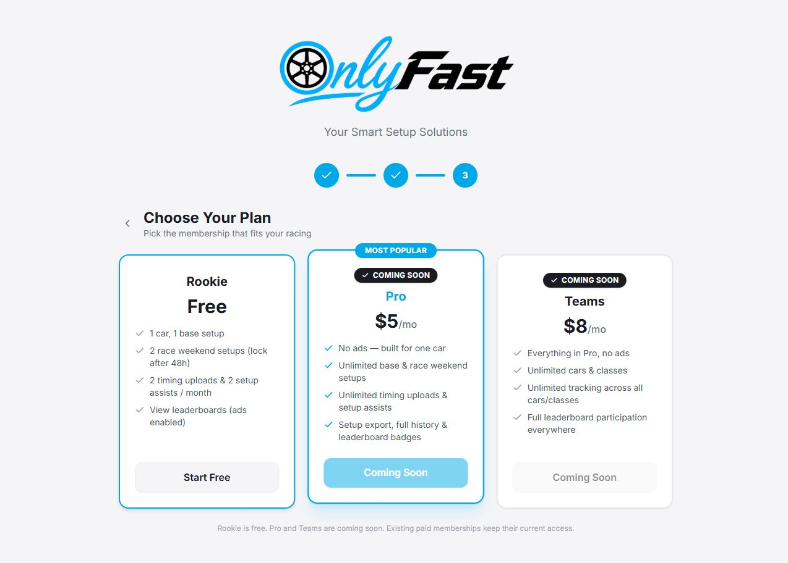
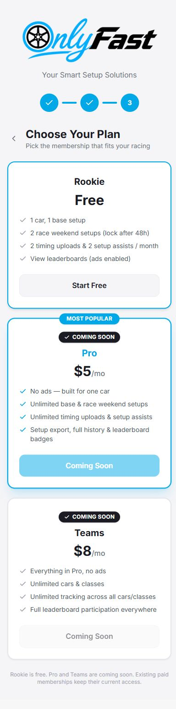
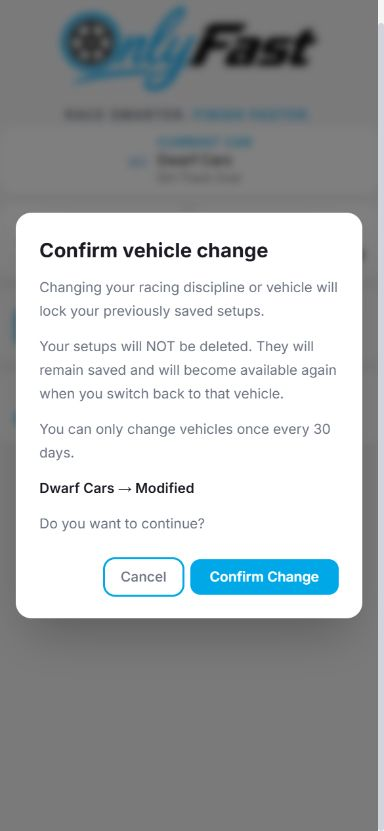

# OnlyFast onboarding and vehicle switching restoration

Implemented and verified locally on October 13, 2026. The live Supabase project was inspected read-only. A final read confirmed that `complete_racing_onboarding()` and `onboarding_step` are not yet present in production. This change has not been deployed or applied to live user data.

## Root cause and restored navigation

The existing `OnboardingFlow` explicitly removed plan selection and called the completion handler immediately when a class was selected. `AppLayout` also marked the tutorial as full onboarding completion. Four discipline cards and their implemented sheets were hidden behind experimental-account access, while the existing class-change RPC enforced seven days.

The restored sequence is authentication → tutorial → discipline → class → Choose Your Plan → landing. Both tutorial Finish and Skip save the discipline step. Replay help retains Close and returns to the existing landing without changing selections.

These screens use the existing `/` and `/account` app route and component state; no competing routes or full-page reloads were added. The protected `/onboarding-preview` reuses the restored picker and plan cards without account writes. Existing configured users bypass onboarding. Unfinished authenticated users resume their server-saved discipline, vehicle, or plan step; an unfinished tutorial resumes at the tutorial.

Rookie is selectable. Pro and Teams retain existing feature descriptions and show disabled Coming Soon controls with no checkout handlers. This restriction is scoped to onboarding. Stripe, native billing, subscription rows, and paid entitlements are retained.

## Database migration and deployment order

This task adds `supabase/migrations/202610130001_restore_racing_onboarding.sql`.

It reuses `user_subscriptions.active_race_class`, `last_class_change_at`, `race_setups.race_class`, and existing setup JSON snapshots. It adds five nullable fields to the existing subscription record:

- `active_racing_discipline`
- `onboarding_step`
- `onboarding_discipline`
- `onboarding_race_class`
- `onboarding_plan`

Draft selections do not change the active class. Rookie completion sets the active discipline/class, records the onboarding choice, and completes onboarding in one transaction. It does not replace existing plan, status, billing IDs, or the change timestamp.

Concurrent Road Racing work adds `supabase/migrations/20261013183621_enable_road_racing.sql`. It must follow this restoration migration so its additional class IDs and discipline mapping are retained. Both migrations were tested together, including repeated application. Apply these pending migrations in that order before deploying the frontend; do not replay old migrations over the new RPC definitions.

Existing non-null change timestamps are reused. No past dates are invented. Legacy accounts with an active class or class recoverable from their own setup history are treated as complete without altering their saved rows.

## Cooldown and locking

The server locks the user's subscription row and validates the canonical class, account, current selection, and entitlement before an active-class change. A Rookie/Pro change updates the class, derived discipline, and timestamp together. The next eligible instant is the last successful change plus 720 hours, exactly 30 days across daylight-saving changes. The returned date drives the screen and the rejection message.

Initial onboarding does not consume a change. Identical selections return the current state without modifying the timestamp. Rejected, failed, and cancelled changes do not consume a change. Teams and existing trusted full-access accounts retain unrestricted selection and multiple-class setup access.

The existing entitlement resolver is retained. Vehicle authorization uses protected app metadata, subscription rows, and server-held experimental flags, so editing user metadata cannot bypass vehicle locks/cooldowns. Existing admin/Teams promo permissions are grandfathered into a protected app-metadata snapshot. Future grants of unlimited promotional vehicle access must be issued through trusted server app metadata; user-editable metadata alone intentionally cannot grant it.

The confirmation warning appears after selecting a discipline/class and before the mutation. Cancel only dismisses the modal. Mutations capture the initiating account's JWT and reject an identity that already switched; late responses cannot update another account's screen.

Setup locking is derived from active class and server permissions; no saved record receives a permanent lock flag. Locked summaries remain visible with “Locked — Switch back to this vehicle to access this setup.” The summaries retain original schedule IDs. Restrictive RLS prevents an owner's public-share policy from exposing inactive setup values. Writes and deletes also take the subscription lock, and updates cannot move a historical setup to another class or owner. Stale inactive drafts cannot become active saves.

Switching back unlocks original values. Tests compare historical rows and schedule/results records before and after changes. Vehicle changes do not update or delete setups, sessions, scans, results, schedules, or leaderboard rows.

Rookie save counts and the single-car check now follow the active vehicle. Locked historical cars do not prevent creating the new vehicle's permitted setups. The existing one-base/two-weekend limits and 48-hour Rookie edit restriction remain.

## Files changed by this task

Some files also contain concurrent Road Racing edits; this list identifies the restoration work, not ownership of every line in the workspace diff.

| Files | Restoration purpose |
|---|---|
| `src/components/AppLayout.tsx` | Authentication entry, server progress/resume, completion and stable landing navigation |
| `src/components/AuthModal.tsx` | New accounts use Rookie defaults instead of inheriting another account's membership cache |
| `src/components/OnboardingFlow.tsx` | Existing discipline/class screens lead to the restored plan step and persist progress |
| `src/components/PlanSelection.tsx` | Rookie completion; disabled Pro/Teams; retains existing feature descriptions |
| `src/components/ClassChangeModal.tsx` | Discipline filtering, confirmation, authoritative cooldown, historical class choices |
| `src/components/SavedSetups.tsx` | Clear locked-setup explanation |
| `src/components/SetupDashboard.tsx` | Preserve session class associations, reject inactive drafts/payloads, refresh selection data and scope save limits |
| `src/components/CreateBaseSetupView.tsx` | Reject inactive drafts and use active-vehicle save limits |
| `src/components/HomeLanding.tsx` | Show the selected discipline with the vehicle |
| `src/lib/activeClass.ts` | Progress/completion RPCs, extended server state, account-bound mutations |
| `src/lib/membership.ts` | Validate saves against the active vehicle without removing existing limits |
| `src/lib/setupLibraryAccess.ts` | Release existing configured sheets while retaining legacy names and separate experimental account privileges |
| `tests/onboardingNavigation.mjs` | Mounted navigation, confirmation/cancellation, disabled plans, resume, account changes and landing tests |
| `tests/setupLibrary.test.ts` | Update assertions for released sheets and preserve serializer/form checks |
| `tests/setupLibraryDatabase.mjs` | Keep the historical pre-release migration fixture scoped to its original class IDs |
| `tests/racingOnboardingDatabase.mjs` | Real PostgreSQL tests for onboarding, changes, RLS, history, entitlement preservation and concurrent Road Racing migration |
| `tests/racingVehicleAccess.test.ts` | Active-vehicle limits and immutable session payload behavior |
| `tests/racingSelectionAccountSwitch.test.ts` | Captured JWT and switched-account rejection |
| `supabase/migrations/202610130001_restore_racing_onboarding.sql` | Server state, atomic changes, private authorization, cooldown and setup guards |
| This report and three QA PNGs | Verification evidence |

Unrelated pre-existing/untracked files and concurrent work were preserved. Root-level and `supabase/src` source snapshots were not rewritten; Vite builds the active `src` tree.

## Verification

- `npm run test`: **316 passed, 0 failed**, including concurrent Road Racing tests.
- Mounted React and isolated PostgreSQL suites: **38 passed, 0 failed**.
- The PostgreSQL suite was rerun after adding the final schedule-link preservation assertion: **passed**.
- `npm run build`: **passed**; existing large-bundle warning remains.
- Targeted ESLint for the restored gate, picker, plans, class modal, RPC/access helpers and new unit tests: **passed**.
- Full `npm run lint`: **fails** on broader repository issues. It was run and logged; unrelated lint cleanup was not included.
- `npx tsc --noEmit -p tsconfig.app.json`: **fails** at unchanged `src/components/HandlingFeedback.tsx:91`, because `replaceAll` is unavailable with the configured ES2020 library. No restoration type errors remain.
- `git diff --check`: **passed**.
- Browser component fixture at 1280×900 and 390×844: discipline/class → plan → landing, disabled paid controls, warning and Cancel verified. Phone scroll width equals viewport width (390), with no horizontal overflow.

The browser fixture uses actual components and mocked state; it is not a live-account or physical Median-device test. Authentication/navigation, database rules, historical preservation, and account switching were separately tested by the mounted/integration suites.

Reproduce the isolated suites without changing production dependencies:

```powershell
$qaRoot = Join-Path $env:TEMP 'onlyfast-onboarding-qa'
npm install --prefix $qaRoot --no-save --package-lock=false @electric-sql/pglite@0.3.14 react@18.3.1 react-test-renderer@18.3.1
$env:PGLITE_MODULE = Join-Path $qaRoot 'node_modules/@electric-sql/pglite/dist/index.js'
$env:REACT_TEST_RENDERER_MODULE = Join-Path $qaRoot 'node_modules/react-test-renderer/index.js'
node --experimental-strip-types --test tests/onboardingNavigation.mjs tests/racingOnboardingDatabase.mjs tests/setupLibraryDatabase.mjs tests/revenuecatDatabase.mjs
```

## Remaining attention

Production still needs the reviewed migrations and frontend deployment. Run a signed-in smoke check on desktop/mobile web and actual Android/iOS Median wrappers after deployment; no physical devices were available here. The existing full-repository lint/ES2020 type-check issues remain outside this restoration.

Read-only live Supabase advisors also reported existing function grants/search-path warnings. The restoration revokes anonymous access to its authenticated racing RPCs and keeps new privileged logic in a private schema. Other pre-existing advisor notices were not changed. See the [Supabase function-permission advisor guidance](https://supabase.com/docs/guides/database/database-linter?lint=0028_anon_security_definer_function_executable) for those existing notices.

## Browser evidence

Actual components rendered in a local fixture; no real account/database changes.






